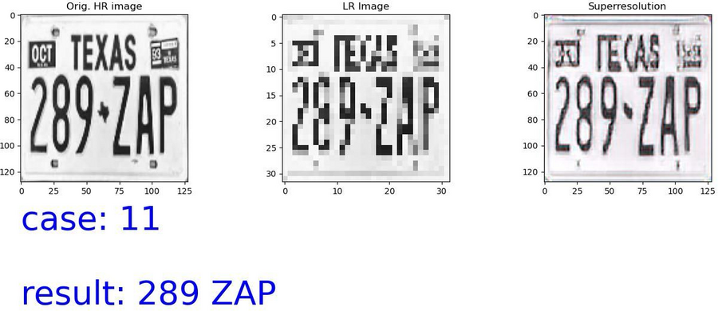
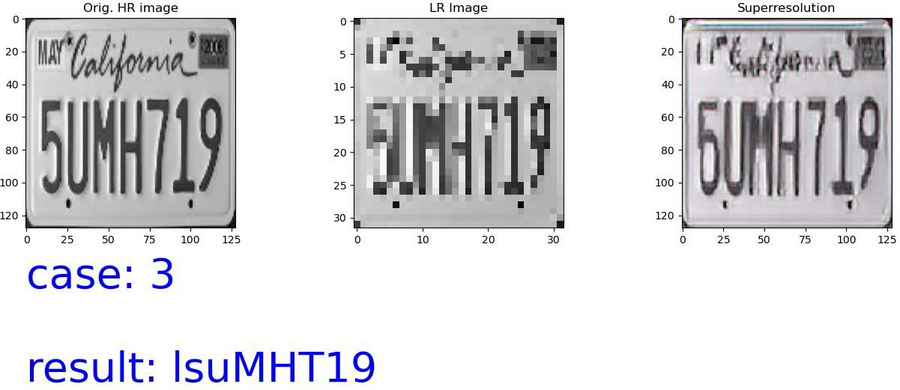
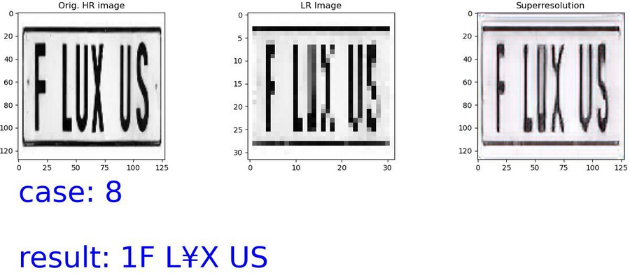

# License Plate Recognition from Extremely Low-Resolution Images

Restoring unreadable 32×32 license plate images with a **Super-Resolution GAN (SRGAN)** and reading the plate number with **OCR**.



> Academic project, B.Sc. Software Engineering (Data Science track), Jerusalem College of Technology.

## Results

On 15 test plates downscaled to 32×32:

| Metric | Low-res input | After SRGAN |
|---|---|---|
| Human identification accuracy | 65% | **92%** |
| OCR (Tesseract) accuracy | n/a | 65% |

Plates that were mostly unreadable became readable in almost every case. Several plates, such as `289 ZAP` above, were also read by the OCR with 100% accuracy. Full per-plate results: [images/results_table.png](images/results_table.png).

| | |
|---|---|
|  |  |

## How it works

```
input image ─► downscale to 32×32 (simulated low-res capture)
            ─► SRGAN generator, 4× upscaling ─► 128×128 image
            ─► OpenCV cleanup (Canny edges, thresholding, blur, keep 8 largest objects)
            ─► Tesseract OCR ─► plate number
```

### SRGAN model ([`srgan/model.py`](srgan/model.py))
- **Generator** (~2M parameters): 9×9 input conv, 16 residual blocks (conv, batch norm, PReLU) with a global skip connection, and two 2× upsampling blocks.
- **Discriminator**: 8 convolutional blocks (64 → 512 filters, LeakyReLU) and a dense head that classifies real vs. generated images.
- **Loss**: adversarial loss (binary cross-entropy, weight 1e-3) plus a **perceptual content loss**: MSE between VGG19 feature maps (block 3) of the generated and real images.

### Training ([`train.py`](train.py))
- Paired grayscale images, HR 128×128 and LR 32×32, built by [`prepare_dataset.py`](prepare_dataset.py).
- The dataset was expanded by hand-editing images and adding visual elements, so the model sees as many real-world cases as possible.
- 67/33 train/test split, 10 epochs, batch size 1.

### Making SRGAN output OCR-friendly ([`pipeline.py`](pipeline.py))
Raw SRGAN output still confused Tesseract, so a preprocessing stage adds Canny edges back to sharpen character outlines, binarizes and denoises the image, and keeps only the 8 largest connected components (the characters).

## Usage

```bash
pip install -r requirements.txt
# Tesseract OCR must be installed: brew install tesseract / apt install tesseract-ocr

python pipeline.py path/to/plate.jpg     # prints the plate text, saves result.png
python app.py                            # desktop GUI
```

The trained generator is included at `models/generator.h5`. Input images should be cropped tightly around the plate.

Training from scratch:

```bash
python prepare_dataset.py --src data/original --out data/train
python train.py --data data/train --epochs 10
```

## Tech stack

Python · Keras / TensorFlow · OpenCV · Tesseract (pytesseract) · NumPy · Tkinter

## Authors

Ori Shoshana and [teammate name]
